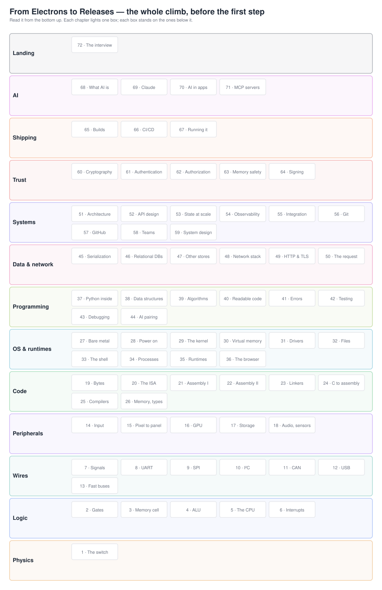
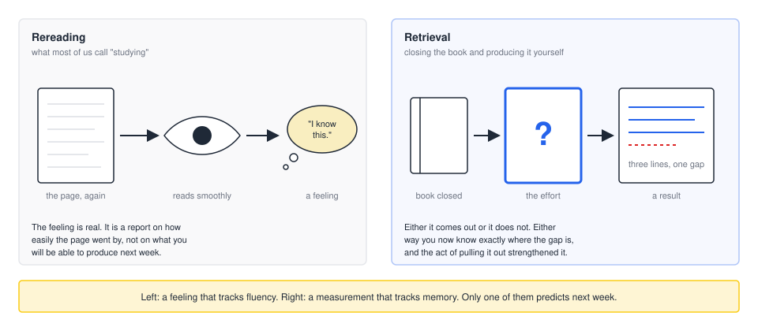
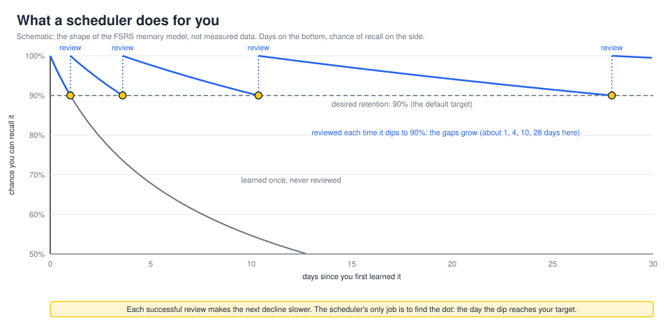
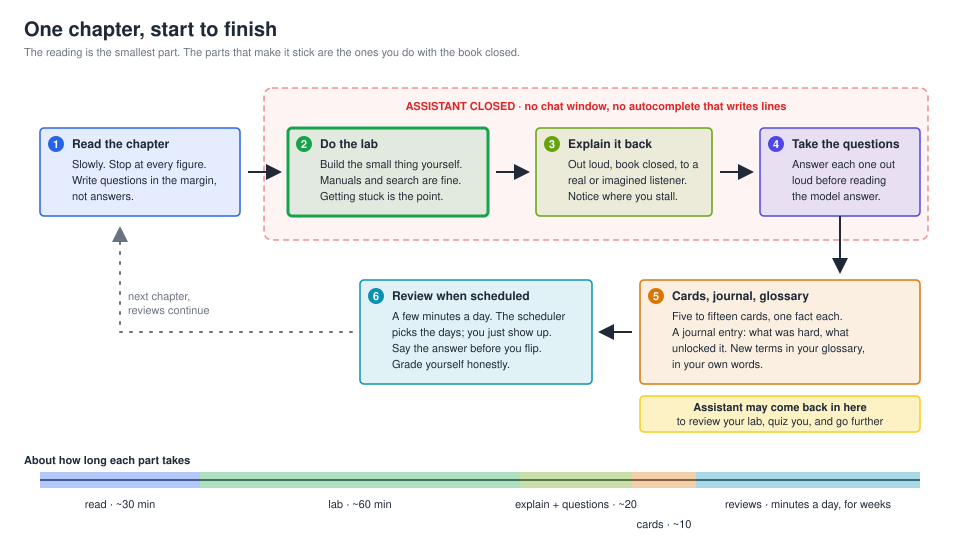
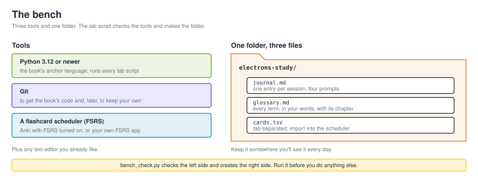

# Chapter 0 — How to study this book

**Before Part 1** · Reading time: about 30 minutes · Lab: about 1 hour · You'll need: a computer with Python 3 and Git (the lab checks for them and tells you where to get them), and about ten minutes a day afterward

## Where we are



*Figure 0.0 — The whole climb, before the first step. Thirteen bands, seventy-two boxes, read from the bottom up. Every chapter from here on lights one box and stands on the boxes below it. Right now nothing is lit. That is the correct starting condition.*

This is the picture the rest of the book fills in. At the bottom is a single electron in a piece of silicon. At the top is a release: a signed, tested piece of software running on a machine somewhere, doing work for a person. Between them are seventy-two boxes, and the claim of this book is that every one of them can be understood by a person who starts at the bottom and does not skip.

Every chapter in this book holds you to the same three tests, and reading alone passes none of them. **Build it without AI**: a small lab you complete with no assistant open. **Explain it back**: you teach the chapter's idea to someone, out loud, and they push until it holds. **Survive the question**: one or two real interview questions on that layer, answered without the page. Everything in this chapter is about how to pass those three, chapter after chapter, without burning out.

There is no previous chapter to pick up from. What this chapter leaves for the next one is not a fact about electrons. It is a habit. Every chapter after this one assumes you are running the loop described here, and the labs assume you have the bench set up at the end of it. So this is the one chapter you should not skim on the way to the interesting parts. The interesting parts will not stick without it.

## The idea

> **You will not learn this book by reading it.** You learn it by closing it and producing what was in it, by building the thing, saying it out loud, and answering a question about it, on a schedule that lets you forget a little first.

## The concept

### The technician who could fix anything

Let me tell you about a kind of person you find in every service shop, and that I have been.

A good field technician walks up to a machine that is down, listens for about a minute, looks at two readings, and says what is wrong. Ninety seconds. He is usually right. Now put a trainee next to him and ask him to explain why he knew. He will say something like "it just sounded like the supply." Push him: what about the sound? What would it have sounded like if it were the other thing? He gets vague. Not because he is hiding anything. Because the knowledge is real, and it is not in words. It is in pattern. He has seen four hundred supplies fail and his brain has quietly built a detector, and the detector does not come with a printout.

That kind of knowing is valuable. It is also fragile in a specific way: it stops at the edge of what you have seen. Give that technician a fault that looks like a supply and isn't, and the detector fires anyway. Give him a brand new machine with a different supply, and the detector is silent. And ask him to teach it, and he cannot, because there is nothing to hand over.

I spent a long time in hardware, where this kind of knowing is normal and mostly fine, because the machines don't change that fast and you can always get the scope out. Then I started shipping software, and I did most of it the way a lot of people do now: by describing what I wanted to an AI and reading what came back. It worked. The things ran. And I knew, in the way you know a tooth is going bad before it hurts, that I was the technician again. I could make it work. Ask me why it worked, or what would happen if one line changed, and I would reach for the page.

The page is the problem. This chapter is about how to stop needing it.

### Two kinds of knowing

Here is the distinction the whole chapter rests on. Hold it carefully, because it sounds obvious and it is not.

**Recognition** is knowing something when you see it. You read a sentence about how a thermostat waits until the room is a little colder than the setting before it turns the heat on, and it makes sense, and you nod. If I showed you that sentence tomorrow with one word wrong, you might catch it. That is recognition. It is real, and it is cheap, and it is what rereading produces.

**Recall** is producing something when nothing is in front of you. I say "thermostat," you have a blank page, and you draw what it does and explain why it waits. That is recall. It is what a lab needs, what explaining to a colleague needs, and what an interview needs. Nobody in an interview will hand you the sentence and ask if it looks right.

The trouble is that recognition *feels* like recall. When the page reads smoothly, your brain reports "I know this," and the report is honest about one thing (the page read smoothly) and silent about the other (whether you could produce it cold). Researchers who study this call the feeling *fluency*, and the mistake it leads to the *illusion of competence*. Here is the picture.



*Figure 0.1 — Left: rereading. The page goes in, it reads smoothly, and a feeling comes out. Right: retrieval. The book is closed, there is effort, and an answer comes out, or part of one. The feeling on the left is about how easily the page went by. The result on the right is about what you can produce. Only the right side predicts what you will have next week.*

Try it on something you own. Without looking, draw the back of your own phone: every camera, the flash, the logo, where the text is. You have seen it ten thousand times. Most people get it wrong in at least two places. You *recognize* the back of your phone perfectly. You cannot *recall* it. Those are different things, and the difference is invisible until you try to produce.

Two psychologists, Asher Koriat and Robert Bjork, found a clean way to show why the illusion happens.[^1] They gave people word pairs to learn and then asked them to predict, pair by pair, how likely they were to remember the second word when shown the first. Some pairs were tricky: the second word strongly suggested the first, but not the other way around. Think of a pair like *cheddar – cheese*. Shown both words together, they feel obviously related, and people predicted they would remember *cheddar* easily. But at test, shown only *cheese*, far fewer could produce *cheddar*; *cheese* on its own leads to a hundred other places. In their numbers, people predicted about 76% success on such pairs and got about 60%. On the pairs where the first word genuinely led to the second, prediction and reality matched. The lesson they drew has a name, *foresight bias*: when the answer is in front of you, you cannot help judging the question as if the answer will be there later. It won't be. At test, the answer is exactly the thing that is missing.

Notice what this means for a textbook. When you read a worked solution and nod, you are in the condition where this bias is largest. Both halves are on the page. Of course it looks learnable.

### The fix is the test

If the illusion comes from always having the answer in view, the fix is to take the answer away and see what comes out. That sounds like an exam, and people hate exams, so let me show you why you should want them.

In 2006, Henry Roediger and Jeffrey Karpicke ran what is now a classic experiment.[^2] Students read short prose passages. Then one group read them again, and another group put the passage away and wrote down everything they could remember, with no feedback and no second look. A few minutes later, the rereaders did better: 81% recalled against 75%. A week later, it had flipped hard: the group that had tested themselves recalled 56%, the rereaders 42%. In a second experiment, students who read a passage four times remembered 40% a week later; students who read it once and tested themselves three times remembered 61%. The rereaders had seen the passage about fourteen times to the testers' three and a half. And here is the part that matters most for you: the rereaders *predicted* they would do best. They had the strongest feeling of knowing and the weakest knowledge.

Five years later, Karpicke and Janell Blunt pushed it further.[^3] They compared retrieval practice against *concept mapping*, where you draw a diagram of the ideas while the text is open in front of you, which is about as active as studying gets. A week later, on a test that mixed straight factual questions with ones that required inference, the retrieval group scored 67% and the mapping group 45%. Then they asked the students beforehand which method would work best. Most predicted the opposite of what happened.

This result has been checked many times since. A *meta-analysis* is a study that pools the results of many earlier studies to see what they say together, and there have been several. One from 2014 pooled 61 laboratory studies and found a medium-sized advantage for testing over restudy, about half a standard deviation, growing to about 0.7 when the final test was a day or more away.[^4] (A standard deviation is a unit for how spread out a set of scores is; an effect of half of one is statisticians' way of saying "clearly there, not enormous.") A 2021 meta-analysis of 222 studies in real classrooms, nearly fifty thousand students, found the same medium effect, and found it held across subjects and ages.[^5] In 2013 a panel of five researchers reviewed ten popular study techniques for the Association for Psychological Science and rated two of them "high utility": practice testing and spreading study out over time. They rated rereading and highlighting "low."[^6] Not harmful; just unreliable.

A caution, because this book is not going to oversell anything. Retrieval practice is not magic. The effect is medium, not enormous. In the short term (minutes) rereading actually wins, which is exactly why it fools people. The meta-analysis found that if you test yourself without feedback and can only recall half the material, the benefit mostly disappears; you need to succeed often enough, or check the answer afterward, for the practice to build anything.[^4] And the studies disagree about which *kind* of test is best, so I am not going to tell you that one format beats the rest. What they agree on is the shape: closing the book and producing the material beats looking at it again, and the gap widens with time.

### Why it has to be uncomfortable

There is a reason retrieval works and rereading doesn't, and knowing it will keep you honest when the loop in this chapter starts to feel like too much effort.

Robert Bjork and Elizabeth Bjork describe a memory as having two strengths.[^7] *Storage strength* is how well a memory is woven into everything else you know, how durable it is. *Retrieval strength* is how accessible it is right now. The catch is that what you can measure in the moment, how fast and fluently something comes to mind, is retrieval strength, and anything that pumps retrieval strength fast, like reading the same page three times in a row, looks like learning while doing very little for storage. Then it fades. The conditions that build storage strength, on the other hand, tend to make the moment harder: spacing study out so that some forgetting has happened, mixing topics instead of blocking them, and testing instead of re-presenting. The Bjorks call these *desirable difficulties*.

The word *desirable* is doing real work. A difficulty is only desirable if you can meet it. If I handed you a lab from Chapter 30 today, that is not a desirable difficulty; it is a wall. The point is not to make things hard. The point is that the kind of effort that feels like struggling to produce something you half-know is the effort that builds the memory. Weightlifting is the obvious comparison: the set that builds muscle is the one where the last rep is hard. The place the comparison breaks is that a weight you cannot lift at all does nothing for you, and neither does a question you have no way to approach. So this book sizes every lab to be hard the right way: you should get stuck, and you should be able to get yourself unstuck with the chapter and the manual.

Two more pieces of the same picture. In 1978 Norman Slamecka and Peter Graf showed that a word you *generate* yourself, even from a heavy hint, is remembered better than the same word read off a page; they called it the *generation effect*, and it held in every variation they tried.[^8] And in 1994 Michelene Chi and her colleagues had eighth-graders read a text about the circulatory system; some were asked to explain each sentence to themselves as they went, the rest simply read it twice. The explainers gained more, and on the hardest questions they gained nearly twice as much.[^9] A 2018 meta-analysis of 64 studies put the self-explanation effect at about half a standard deviation overall. The detail worth remembering: prompts that asked *why does this step work* were strong, with an effect near 0.9; prompts that only asked *how well do you understand this* were near zero.[^10] Asking yourself whether you get it does nothing. Making yourself say why it works does a lot.

Producing beats receiving. Explaining beats nodding. Every structural choice in this book follows from those two sentences.

### Forgetting is a tool

Now the part that sounds backwards. To remember something for a long time, you have to let yourself forget it a little, and then pull it back.

In 1879 and 1880 a German psychologist named Hermann Ebbinghaus ran an experiment on the only subject he trusted: himself.[^11] He made up about 2,300 nonsense syllables (*ZOF*, *KEM*, that sort of thing) so that nothing he learned would be helped by meaning. He read lists of them aloud at a fixed pace until he could recite a list perfectly. Then, after a delay of twenty minutes or an hour or a day or a month, he learned the same list again and timed how much faster it went. The time saved was his measure of how much had survived. After twenty minutes he saved about 58% of the original time. After an hour, 44%. After a day, 34%. After a month, 21%.

You have probably seen "the Ebbinghaus forgetting curve" on a slide somewhere, usually with confident percentages like "you lose 70% in a day." Those numbers are not his. He measured time saved on relearning, not percent remembered, and he said plainly that his results applied to his own case.[^11] A 2015 replication with one other subject found the same *shape*, steep at first and flattening out, with the specific numbers a little different.[^12] The shape is the thing to keep: forgetting is fast at first and slow later. Everything else on those slides is decoration.

What Ebbinghaus also noticed, in a later chapter, is that repetitions spread over days beat the same number of repetitions crammed together.[^11] That observation has since become one of the most replicated findings in the study of memory. A 2006 review pooled 271 experiments comparing spaced study against massed study, with total study time held equal, and found 47% final recall for spaced against 37% for massed; only twelve of the 271 comparisons failed to show the benefit.[^13] Two years later the same group ran a study on 1,354 adults learning trivia facts, varying the gap between the first study and a second one from zero to 105 days, and then testing a week to a year later.[^14] The best gap depended on how long you needed to remember: about three days if the test was in a week, about a month if the test was in a year. In every case, the right gap beat no gap by a wide margin, and a gap that was too long started to hurt.

So there is a sweet spot. Review too soon and you are rereading: fluent, easy, useless. Review too late and the memory is gone and you are starting over. Review when it has faded *just enough* that pulling it back takes effort, and that effort is the desirable kind. The trouble is that the sweet spot moves. It is a day out for a new fact and a month out for a fact you have pulled back five times. Nobody can track that by hand for a few thousand facts.

### The scheduler

That is what a flashcard scheduler does. It tracks, for every card, roughly when the memory will have faded to the point where a review is worth it, and it puts the card in front of you on that day. Here is what the idea looks like drawn.



*Figure 0.3 — What a scheduler does for you. The grey curve is a fact learned once and left alone. The blue curve is the same fact reviewed each time its chance of recall dips to about 90%. Each successful review resets it and makes the next decline slower, so the reviews land at roughly one, four, ten, and twenty-eight days. This is the shape of the FSRS model, not measured data; your cards will have their own curves.*

The scheduler this book recommends is called FSRS, the Free Spaced Repetition Scheduler. It is open source, it is built into the most widely used flashcard program, Anki, and its model is simple enough to explain in a paragraph.[^15]

FSRS describes each card with three numbers. **Retrievability** is the chance you could recall the card right now; it falls every day you don't review. **Stability** is how many days it takes for retrievability to fall from 100% to 90%; a card with a stability of 365 will still be at 90% a year from now. **Difficulty** is how hard the card is for you, which governs how much stability grows after each successful review. When you review a card and grade yourself, the scheduler updates stability and difficulty; then it computes the next day on which retrievability will hit your target. The default target is 90%, which the Anki manual notes is about where the workload is reasonable; push it toward 97% and the number of reviews climbs fast.[^16] The parameters behind the model were fit to several hundred million real reviews from about ten thousand Anki users,[^15] and the method descends from a 2022 paper that treated scheduling as a route-finding problem: of all the possible sequences of reviews, find the one that gets a memory to the target strength at the lowest total cost in your time.[^17]

None of this is new in spirit. The scheduler FSRS replaced, SM-2, was written by a Polish student named Piotr Wozniak in December 1987.[^18] It started every card at a one-day interval, then six days, then multiplied the interval by an "easiness" number that your grades nudged up or down. It was crude, and it worked well enough that most flashcard software used some version of it for thirty-five years. FSRS does the same job with a model that predicts your actual memory instead of applying a fixed multiplier.

You do not need to understand the parameters. You need to do three things: turn FSRS on (in Anki it is a switch at the bottom of the deck options, off by default), leave the target at 90%, and show up for your reviews. The scheduler handles the rest. One mechanical note: Anki added FSRS in version 23.10, released in November 2023, and the current version at the time I am writing this is 26.09.[^19] If you already use a different flashcard tool that runs FSRS, including one you built yourself, that is fine. The algorithm is the point, not the app.

### How to write a card

A scheduler is only as good as the cards you feed it, and most people write bad cards. Wozniak wrote a set of twenty rules for this in 1999 that have held up well.[^20] Four of them will carry you through this book.

**Don't memorize what you don't understand.** A card is for keeping something you already understand from fading. It is not for learning it in the first place. If you find yourself making a card for a thing that doesn't make sense yet, stop, go back to the chapter, and get it to make sense. Then make the card.

**One fact per card.** This is Wozniak's *minimum information principle*. A card that asks for three things will be half-remembered forever, because the scheduler cannot tell which third you forgot. Split it. Three cards that each ask one thing will be learned faster than one card that asks three.

**Hide one thing in a sentence you understand.** Wozniak calls this *cloze deletion*: take a true sentence and blank out one word. "Ebbinghaus measured memory by the ________ saved when he relearned a list" (answer: *time*). Clozes are fast to write and they keep the fact in its context.

**Avoid lists.** "Name the four desirable difficulties" is a terrible card. You will remember three and feel bad. If something is genuinely a list, make a card for each item that asks *why that item belongs*, not for the list.

Here is the difference on a card drawn from this chapter.

> **Bad card.** Front: *What did Roediger and Karpicke find?* Back: *Testing beat rereading at one week, 56% vs 42%; rereaders predicted the opposite; the second experiment compared four readings against one reading plus three tests…*
>
> **Good card.** Front: *In Roediger & Karpicke (2006), the students who tested themselves instead of rereading remembered ______ a week later vs 42% for rereaders.* Back: *56%.*
>
> **Another good card.** Front: *Why does rereading feel like it works when it doesn't?* Back: *It raises fluency (retrieval strength) now, which feels like knowing, without building storage strength.*

The first card will never be "learned." The second two will be, in a few reviews each.

Five to fifteen cards per chapter is plenty. More than that and you are transcribing the chapter into cards, which is rereading with extra steps.

### Explain it back

You have probably heard of "the Feynman technique": explain the idea as if to a child, notice where you stumble, go back and fix that, simplify, repeat. It is good advice. I owe you the truth about the name, though, because this book is going to be careful about sources and that includes the folklore.

Richard Feynman never wrote down a four-step technique. The packaging under his name appears around 2011 on a blog about learning faster, and spread from there.[^21] What Feynman actually did is better, and it is in his biographies. Before his doctoral oral exams at Princeton, he opened a fresh notebook, titled it "Notebook of Things I Don't Know About," and spent weeks taking each branch of physics apart looking for the rough edges he could not explain.[^22] And years later, when a colleague asked him to explain why a certain class of particles obeys a certain statistical law, he said he'd prepare a freshman lecture on it, came back a few days later, and said he couldn't reduce it to that level, which meant nobody really understood it yet.[^23] In the preface to his famous lectures, he wrote that he didn't think the lectures had served the students well, and that the best teaching happens in the direct relationship where a student thinks and talks ideas through.[^24]

So the technique popularly named after him is really two habits he had: keep a running list of what you can't yet explain, and treat "I can't explain it simply" as a finding about your understanding, not about the topic. The research on self-explanation I showed you above says those habits work, and says specifically that the explaining has to be about *why*, not about *whether you get it*.[^10]

In this book, "explain it back" has a concrete form. At the end of every chapter there is a prompt: explain this idea to a named kind of listener, out loud, with the book closed, in a few minutes. The prompt tells you what a good explanation must include and the most common way it goes wrong. Do it out loud. Writing lets you hide behind the backspace key; speaking doesn't. Record yourself if nobody is around. You will hear exactly where you stall, and the stall is the gap.

If you are working with Claude, this is where it comes back into the room, and it comes back in one specific role: the interviewer. You explain; it asks the follow-up a real interviewer would ask; it does not give you the answer until you have committed to one; and it tells you plainly when your explanation would not have survived. That role is written into the instructions this book was built with. Hold it to that. An assistant that supplies the answer the moment you hesitate is the page again.

### The journal and the glossary

Two files, kept for the whole book.

The **journal** is one entry per study session. It is not a diary. Research on learning journals is clear that free-form reflection does very little, and that a journal works when it makes you do three things: restate the idea in your own words, name exactly what is still unclear, and say what you will do about it.[^25] A 2020 synthesis of twenty studies found that prompted journals beat unprompted ones by a wide margin, about three-quarters of a standard deviation, and that the strongest format pairs the restating with the gap-naming. So the journal has four prompts, and they are the same every time:

1. **What I did.** One line.
2. **What was hard, and where exactly I got stuck.** Not "the lab was hard." Which step, what you tried, what happened.
3. **The sentence or picture that made it click**, or "it hasn't yet." This is the most valuable line in the whole file. Months from now, when you teach this to someone, that is the sentence you will give them.
4. **What I predict will be hard next chapter.** Predictions make you notice when you were wrong, and being wrong about yourself is useful information.

The **glossary** is every term the book defines, in your words, with the chapter it came from. Not the book's definition; yours. If you can't write a term's line without looking, the term is not yours yet, and that is a card you need. The book keeps its own glossary too, and you should check yours against it now and then, but the act of writing your own is the point.

### Labs with no AI open

Every chapter has a lab, and every lab says the same thing at the top: do this with no AI assistant open. Not Claude, not a chat window, not an autocomplete that writes whole lines. You may use manuals, datasheets, the chapter, and a search engine for error messages. I want to show you the evidence for that rule, because "it builds character" is not an argument, and because I use these tools every day and I am not asking you to pretend they don't exist.

The clearest study so far comes from a large high school in Turkey, where roughly a thousand students were randomly assigned, by classroom, to one of three conditions for their math practice sessions.[^26] One group had the textbook. One had a plain GPT-4 chat. One had GPT-4 wrapped in teacher-written prompts that made it give hints rather than answers. During practice, the plain-chat group did about 48% better than the textbook group, and the hint-only group did about 127% better. Then everyone took a closed-book exam with no tools. The plain-chat group did about 17% *worse* than the students who had only had the textbook. The hint-only group did about the same as the textbook group: no harm, and no gain either. The students who had used the plain chat did not think they had learned less. They had asked it for answers, gotten them, felt good, and learned less than the kids with the book.

A smaller controlled study with young novices learning Python found a similar gap in a milder form: students with a code generator completed tasks with about 80% correctness while it was on, and about 60% once it was off, roughly the same as students who never had it.[^27] The assistant made them look better than they were without, in that design, making them worse. Two other studies, one a set of lab observations of novice programmers and one a pair of experiments in university Python courses, found the same mechanism from different angles: students who used the assistant to *produce* solutions came away with an illusion of competence and less understanding per topic, while students who used it to *explain* things they were already working on did fine, and the gap between strong and weak students got wider.[^28] A widely shared 2025 preprint from MIT (a *preprint* is a paper released before other researchers have reviewed it) put EEG caps, which read the brain's electrical activity through the scalp, on people writing essays with and without ChatGPT and found weaker neural connectivity and much worse recall in the assisted group: 83% of the assisted writers could not quote a sentence from the essay they had just written.[^29] I want to be careful with that one. It is a preprint, with eighteen people per group, and it measured essay writing over a few months, not long-term harm. It is consistent with everything above; it is not proof of anything on its own.

On the other side of the ledger, a randomized trial in a Harvard physics course found that a carefully engineered AI tutor, with expert-written prompts and reference answers, loaded to respond only to the student's own attempts, produced *better* learning than an in-class active-learning session.[^30] That is the same lesson as the Turkish study's hint-only group, from the positive direction: the tool is not the problem. Using it to skip the production step is the problem.

So here are the rules of engagement for this book, and the reasons are above.

- **During the lab, the assistant is closed.** The lab is the production step. Everything in this chapter says the production step is where the learning happens, and that an answer supplied at the moment of struggle removes it.
- **After you have committed to an answer, the assistant may come back.** Review the lab with it. Ask it what you did badly. Ask it to quiz you. Ask it the question you got stuck on, *after* you have written down your own best guess in the journal.
- **For "explain it back" it is the interviewer**, as described above. It asks; you answer; it does not rescue you.
- **For going further, it is a tutor.** Once the lab is done and yours, use it freely to push past the chapter.

The simplest test of whether you are on the right side of the line: are you asking it to produce something you were supposed to produce, or to react to something you produced? The second is learning. The first is the page.

Here is the whole loop in one picture.



*Figure 0.2 — One chapter, start to finish. Read slowly; do the lab with nothing open but the chapter and the manuals; explain it back out loud; take the interview questions before reading the model answers; make your cards and write your journal entry; then let the scheduler bring the cards back on its own days. The dashed region is where the assistant stays closed. The reading is the smallest part.*

### How to tell understanding from recognition

The whole chapter comes down to a question you will ask yourself at the end of every chapter: do I actually know this, or do I recognize it? You now know why the feeling of knowing is unreliable. Here are four tests that are reliable.

**Can you build it cold?** Not the lab you already did; a small variation of it, with the chapter closed. If the lab had you read one sensor, can you read a different one without looking anything up but the datasheet?

**Can you predict before you run it?** Before you execute a line, say what it will print. Before you flip a switch, say which way the trace moves. If you cannot predict, you do not have a model; you have a recipe.

**Can you explain it without the page, to someone who will ask why?** Not "a thermostat turns the heat on when it's cold." Why does it wait until the room is a degree below the setting? What would go wrong if it didn't? What is inside it that makes the decision?

**Can you survive the follow-up?** Every interview question in this book comes with the follow-up a real interviewer would ask. The first answer can be memorized. The follow-up cannot.

These are the three tests from the start of the book with one added. Pass all four and the box on the master diagram is yours. Pass only the feeling and it is not, no matter how clearly the chapter read.

### Your bench



*Figure 0.4 — Everything you need before Chapter 1. Three tools on the left; one folder with three files on the right. The first lab script checks the tools and creates the folder.*

You need **Python 3**, version 3.12 or newer. It is the language the book's code is written in, and almost every lab script is Python. The current release when I am writing this is 3.15, from October 2026;[^31] anything from 3.12 on will run everything in the book. You need **Git**, which you will use in the next few chapters only to fetch the book's code, and later to keep your own.[^32] You need a **flashcard tool running FSRS**: Anki is free, runs on everything, and is what the lab assumes;[^19] anything else that runs FSRS is fine. And you need a text editor you already like. That is the bench. Everything else, including the hardware kit for Part 1, comes later and is listed in the chapter that first needs it.

## A worked example

Let me run one idea through the whole loop so you can see it done before you do it. The idea is this chapter's own: *retrieval beats rereading, and the feeling of knowing can't tell the difference.*

**Read.** You just did. Along the way you should have written a few questions in the margin rather than answers. One a first reader of this chapter might write: *if the rereaders predicted they'd do best, what was their prediction based on?* (Answer, from the chapter: on fluency, which is exactly the thing that doesn't predict.)

**Lab.** The lab below has you close this chapter and write down everything you remember, then compare. That is retrieval practice on retrieval practice, which is either elegant or annoying depending on your mood.

**Explain it back.** Out loud, book closed, ninety seconds, to a friend who studies by rereading highlighted notes. A version that would pass:

> "When you reread, the page goes by smoothly, and your brain tells you that you know it. But that feeling is about how easy the page was, not about whether you could produce it tomorrow. The way to find out is to close the book and try to produce it. That feels worse, because it's hard, and that's the sign it's working: there's a classic study where people who tested themselves remembered 56% a week later and the rereaders remembered 42%, and the rereaders were the ones who thought they'd do best. So: close the notes, write what you remember, then check."

That has the mechanism (fluency isn't memory), the fix (retrieve), the evidence (one number, not six), and one concrete change. It would survive the follow-up "why does it feel worse?" because you can say: because the answer isn't in front of you, and that is the whole point.

**Cards.** Three, from the examples above: the 56% vs 42% cloze, the *why does rereading feel like it works* card, and one more: *Front: In FSRS, "stability" is the number of days until the chance of recall falls to ____%. Back: 90.* Notice that last one is a number I could easily misremember as 50%, which is why it earns a card.

**Journal.** Four prompts. An example entry, the kind a first reader might write: *Did: read Chapter 0 and the two main studies it leans on. Hard: I kept wanting to believe the "70% in a day" curve and had to go read what Ebbinghaus actually measured. Clicked: "at test, the answer is exactly the thing that is missing." Predict: Chapter 1's physics will feel easy and I'll be tempted to skip the lab; don't.*

**Review.** The three cards will come back tomorrow, then in a few days, then in a couple of weeks. Each time, say the answer before you flip. Grade honestly: "I knew it instantly" and "I got it after a struggle" are different grades, and the scheduler needs the difference.

That is the whole loop. Thirty minutes of reading, an hour of lab, twenty minutes of talking and writing, and then a few minutes a day. Seventy-two more times.

## Lab

> **Do this with no AI assistant open.** Not Claude, not a chat window, not an autocomplete that writes whole lines. You can use the manual, the datasheet, a search engine for error messages, and this chapter. The point is that the thing you build is yours. When you're done, the assistant can come back in to review it and to go further.

**What you'll build.** Your study bench: the tools checked, the study folder created, your first ten cards scheduled, your first journal entry written, and one honest measurement of how much of this chapter you can recall with it closed.

**What you'll need.** A computer. The two scripts for this chapter, in `code/` next to this file: `bench_check.py` and `recall_check.py`. An internet connection for the installs. No hardware.

**How long.** About an hour.

**Steps.**

1. **Check the bench (10 minutes).** Open a terminal. If you have never done that: on Windows, search for *Terminal* or *PowerShell*; on a Mac, *Terminal* is in Applications → Utilities; on Linux you already know. Change into the `code/` folder for this chapter and run:

   ```
   python3 bench_check.py
   ```

   (On Windows it may be `python` or `py` instead of `python3`.) It prints one line for Python and one for Git, marked `ok`, `OLD`, or `MISSING`, then creates a folder called `electrons-study` in your home directory with three files in it. (Pass a different path as an argument if you want it somewhere else; the script prints where it put things.) If Python is missing or older than 3.12, install the current version from python.org and run the script again.[^31] If Git is missing, install it from git-scm.com.[^32] On a Mac, typing `git --version` may offer to install the command-line tools for you; say yes.

2. **Set up the scheduler (20 minutes).** Install Anki from apps.ankiweb.net if you don't have it.[^19] Open it, click the gear next to the default deck, choose *Options*, scroll to the bottom, and turn on **FSRS**. Leave *Desired retention* at 0.90. Save. Then, in the `electrons-study` folder the script made, open `cards.tsv` in your text editor. It already has four header lines; leave them alone. Below them, add ten cards from this chapter, one per line, in the form *front, tab, back, tab, ch00*. Write them in your own words following the four rules above: things you understand, one fact each, clozes where they fit, no lists. When you have ten, in Anki choose *File → Import*, pick `cards.tsv`, and confirm the preview shows ten notes with the fields in the right places. (If you use a different FSRS tool, import the file there instead; it is plain tab-separated text.)

3. **Write the journal entry (10 minutes).** Open `journal.md`. The script already wrote today's heading and the four prompts. Fill them in. Two or three sentences each. Be specific in the second one.

4. **The recall check (15 minutes).** Close this chapter. Close the browser tab or the file. Run:

   ```
   python3 recall_check.py
   ```

   (It looks for the journal in `electrons-study` in your home directory; if you put the folder elsewhere, pass the journal's path as an argument.) Type everything you can remember from the chapter, one idea per line: claims, numbers, names, the shape of a figure, anything. Keep going past the point where it feels like you're done; that is where the interesting items are. When you genuinely run dry, type `done`. The script saves the list to your journal with a timestamp and a count. **Now** reopen the chapter and read it against your list. Under the entry, write what you missed and what you had wrong. The count is your baseline. It is probably lower than it felt like it would be. That is the chapter's point, measured.

5. **Set a time (5 minutes).** Pick a time of day for reviews and put it somewhere you will see it. Ten minutes. The scheduler will have nothing for you tomorrow except your ten cards; in a month it will have whatever the book has given you by then, spread thin.

**What success looks like.** `bench_check.py` reports `ok` for both tools. The `electrons-study` folder exists with three files. Anki shows ten new cards in a deck with FSRS on. `journal.md` has one filled-in entry and one recall check with a number next to it. You know your number.

**If it doesn't work.**

- *`python3: command not found`* (or `python` opens the Microsoft Store on Windows): Python isn't installed or isn't on your path. Install from python.org and, on Windows, tick the "Add to PATH" box in the installer. Open a new terminal afterward; the old one won't see the change.
- *`bench_check.py` says `OLD`*: you have a Python older than 3.12. Install the current one alongside it; on most systems the new one becomes `python3` automatically. Run `python3 --version` to check which one you're getting.
- *Anki's import preview shows everything in one field*: the separator wasn't detected. In the import dialog, set the separator to *Tab* by hand. Make sure your editor is inserting real tab characters between fields and not spaces; some editors convert tabs to spaces by default.

**Going further (optional, assistant allowed again).** Hand your ten cards to the assistant and ask it to find the ones that break the four rules. It will find some. Fix them yourself.

## Explain it back

Explain *why rereading feels like learning but isn't, and what to do instead* to a friend who studies for everything by rereading their highlighted notes, out loud, in under three minutes. A good explanation will:

- Say what the feeling of knowing is actually measuring (fluency, how smoothly the page went by) and why that is not the same as being able to produce the material.
- Name the fix (close the book and retrieve) and give one honest piece of evidence for it, with its caveat (it feels worse in the moment and only wins after a delay).
- Say why spacing matters, in one sentence: the review that works is the one that comes after some forgetting.
- End with one concrete thing your friend can do tonight.

The most common way this goes wrong: you explain retrieval practice as "quizzing yourself more," which your friend already believes they do when they reread with a hand over the answers. The difference you have to land is that the answer must be *gone*, not covered, and that the struggle to get it back is the point rather than a sign of failure. If you can't make that distinction clear, you haven't got it yet.

## Interview questions

This is the one chapter whose interview questions are about you rather than about a machine. They are real questions; every one of them is asked in software interviews, and they are asked precisely because they reveal whether a candidate learns by recognition or by recall.

**1. "Tell me about something technical you taught yourself. How did you go about it?"**

*What they're really asking:* Whether you have a method, or whether you learn by osmosis and hope. They are also listening for honesty about what was hard.

*A good answer:* "The most recent one was [a specific thing, named]. I started by reading enough to know the shape of it, but I've learned that reading alone doesn't stick for me, so pretty quickly I switched to building something small with the documentation open and nothing else. I kept a running list of what I couldn't explain yet, and I'd go back to that list rather than rereading the parts I already understood. The thing that actually made it click was [a specific moment]. I knew I had it when I could [predict a behavior / build a variation / explain it to a colleague] without looking. The honest part is that the first version I built was wrong in [a specific way], and finding out why was where most of the learning happened."

*The follow-up you should expect:* "What would you do differently next time?" Have a real answer. "Start the hands-on part sooner" is usually true and usually believed.

**2. "How do you get up to speed on an unfamiliar system or codebase?"**

*What they're really asking:* Whether you can learn a system you didn't build, which is most of the job, and whether you do it by forming a model or by pattern-matching on whatever you saw last.

*A good answer:* "I try to build a model before I build a map. First I find the one path that matters most, say a request coming in and a response going out, and I trace it end to end, reading only what's on that path and writing down the pieces I don't understand yet. I resist reading everything, because reading everything feels productive and I retain almost none of it. Then I change something small on that path and predict what will happen before I run it. If my prediction is wrong, that's exactly where my model is wrong, and I fix the model, not just the code. I keep the list of things I can't explain and work it down. After a few of those loops I can usually draw the system from memory, and that's when I trust myself to make a real change."

*The follow-up you should expect:* "How do you know when you understand it well enough?" The answer is in this chapter: when you can predict it and explain it without the page.

**3. "What do you do when you're asked something you don't know?"**

*What they're really asking:* Whether you bluff. Bluffing is the thing that gets people fired, because it means nobody can trust your yes.

*A good answer:* "I say I don't know, and then I say what I do know and how I'd find out. In an interview that sounds like: 'I haven't worked with that directly. Here's what I understand about the neighboring thing, here's what I'd expect by analogy, and here's how I'd check.' I've learned that the feeling of knowing something is unreliable, so I'd rather be caught not knowing than caught being wrong with confidence. On the job it's the same, except the 'how I'd find out' part is the actual plan."

*The follow-up you should expect:* They may test it on the spot by asking something you plausibly don't know. Do exactly what you just said you'd do. The consistency is the answer.

## What the next chapter builds on this

Chapter 1 is **The electron and the switch**. It starts with a piece of silicon, puts an electron in it, and ends with a transistor that turns on and off when you ask it to, which is the one trick that everything above it in the master diagram is built from.

It assumes three things from this chapter. That your bench is set up and `electrons-study` exists, because its lab writes to the journal and adds to the cards. That you have run the loop once and know what it feels like to measure your own recall, because Chapter 1 is where many readers feel most at home, and feeling at home is exactly the condition where the illusion of competence is strongest; do the lab anyway. And that the assistant stays closed during the lab, because Chapter 1's lab is the first one where a chat window could hand you the answer in one sentence and cost you the chapter.

What this chapter leaves open: nothing technical yet. The first box on the master diagram is still grey. Chapter 1 lights it.

## Sources

[^1]: Koriat, A., & Bjork, R. A. (2005). Illusions of competence in monitoring one's knowledge during study. *Journal of Experimental Psychology: Learning, Memory, and Cognition, 31*(2), 187–194. https://doi.org/10.1037/0278-7393.31.2.187 — Experiment 2: judgments of learning 75.7 vs recall 60.3 on backward-associated pairs; 78.1 vs 78.8 on forward pairs. The *cheddar–cheese* illustration is mine; the paper's stimuli were different word pairs with the same structure.
[^2]: Roediger, H. L., III, & Karpicke, J. D. (2006). Test-enhanced learning: Taking memory tests improves long-term retention. *Psychological Science, 17*(3), 249–255. https://doi.org/10.1111/j.1467-9280.2006.01693.x — Experiment 1: 81% vs 75% at five minutes; 56% vs 42% at one week. Experiment 2: 40% (read four times) vs 61% (read once, tested three times) at one week; rereaders predicted 4.8 vs testers' 4.0 on a seven-point scale.
[^3]: Karpicke, J. D., & Blunt, J. R. (2011). Retrieval practice produces more learning than elaborative studying with concept mapping. *Science, 331*(6018), 772–775. https://doi.org/10.1126/science.1199327 — Experiment 1, one-week delayed test: .67 retrieval vs .45 concept mapping. For the debate over whether the concept-mapping condition was fair, see Mintzes et al. and the authors' reply, *Science, 334*, 453 (2011).
[^4]: Rowland, C. A. (2014). The effect of testing versus restudy on retention: A meta-analytic review of the testing effect. *Psychological Bulletin, 140*(6), 1432–1463. https://doi.org/10.1037/a0037559 — 61 studies; g = 0.50 overall, 0.69 at retention intervals of a day or more, 0.73 with feedback vs 0.39 without; near zero without feedback when initial retrieval success was 50% or lower.
[^5]: Yang, C., Luo, L., Vadillo, M. A., Yu, R., & Shanks, D. R. (2021). Testing (quizzing) boosts classroom learning: A systematic and meta-analytic review. *Psychological Bulletin, 147*(4), 399–435. https://doi.org/10.1037/bul0000309 — 222 studies, 573 effects, 48,478 students; g = 0.499 overall.
[^6]: Dunlosky, J., Rawson, K. A., Marsh, E. J., Nathan, M. J., & Willingham, D. T. (2013). Improving students' learning with effective learning techniques: Promising directions from cognitive and educational psychology. *Psychological Science in the Public Interest, 14*(1), 4–58. https://doi.org/10.1177/1529100612453266 — "High utility": practice testing, distributed practice. "Low utility": summarization, highlighting, keyword mnemonic, imagery for text, rereading. The low rating reflects limited generalizability as of 2013, not evidence of harm.
[^7]: Bjork, E. L., & Bjork, R. A. (2011). Making things hard on yourself, but in a good way: Creating desirable difficulties to enhance learning. In M. A. Gernsbacher, R. W. Pew, L. M. Hough, & J. R. Pomerantz (Eds.), *Psychology and the real world: Essays illustrating fundamental contributions to society* (pp. 56–64). Worth. https://bjorklab.psych.ucla.edu/wp-content/uploads/sites/13/2016/04/EBjork_RBjork_2011.pdf — storage strength vs retrieval strength; the four desirable difficulties; the caveat that a difficulty the learner cannot meet is not desirable. The term originates in Bjork (1994), in Metcalfe & Shimamura (Eds.), *Metacognition*, MIT Press, pp. 185–205.
[^8]: Slamecka, N. J., & Graf, P. (1978). The generation effect: Delineation of a phenomenon. *Journal of Experimental Psychology: Human Learning and Memory, 4*(6), 592–604. https://doi.org/10.1037/0278-7393.4.6.592
[^9]: Chi, M. T. H., de Leeuw, N., Chiu, M.-H., & LaVancher, C. (1994). Eliciting self-explanations improves understanding. *Cognitive Science, 18*(3), 439–477. https://doi.org/10.1207/s15516709cog1803_3 — 24 eighth-graders; prompted explainers gained 32% vs 22% overall and 22.6% vs 12.5% on the hardest questions. Small sample, and the prompted group spent roughly twice as long on task; cited here for the mechanism, with the meta-analysis in the next note for the size of the effect.
[^10]: Bisra, K., Liu, Q., Nesbit, J. C., Salimi, F., & Winne, P. H. (2018). Inducing self-explanation: A meta-analysis. *Educational Psychology Review, 30*, 703–725. https://doi.org/10.1007/s10648-018-9434-x — 64 reports, 5,917 participants; g = 0.55 overall; conceptual "why" prompts g = 0.87; metacognitive "how well do you understand" prompts g = 0.19, not reliably different from zero.
[^11]: Ebbinghaus, H. (1913). *Memory: A contribution to experimental psychology* (H. A. Ruger & C. E. Bussenius, Trans.). Teachers College, Columbia University. (Original work published 1885.) https://psychclassics.yorku.ca/Ebbinghaus/ — Chapter VII, §28: savings of 58.2% at about 20 minutes, 44.2% at 1 hour, 33.7% at 24 hours, 21.1% at 31 days; his statement that the results hold for his own case; Chapter VIII on distributed versus massed repetition.
[^12]: Murre, J. M. J., & Dros, J. (2015). Replication and analysis of Ebbinghaus' forgetting curve. *PLoS ONE, 10*(7), e0120644. https://doi.org/10.1371/journal.pone.0120644 — one subject, 70 lists, intervals from 20 minutes to 31 days; the savings curve matched Ebbinghaus's shape closely when normalized, with the 31-day point lower.
[^13]: Cepeda, N. J., Pashler, H., Vul, E., Wixted, J. T., & Rohrer, D. (2006). Distributed practice in verbal recall tasks: A review and quantitative synthesis. *Psychological Bulletin, 132*(3), 354–380. https://doi.org/10.1037/0033-2909.132.3.354 — 271 massed-versus-spaced comparisons, 14,811 participants; 47.3% vs 36.7% final recall with study time equated; 12 of 271 showed no benefit or a reversal.
[^14]: Cepeda, N. J., Vul, E., Rohrer, D., Wixted, J. T., & Pashler, H. (2008). Spacing effects in learning: A temporal ridgeline of optimal retention. *Psychological Science, 19*(11), 1095–1102. https://doi.org/10.1111/j.1467-9280.2008.02209.x — 1,354 participants; optimal gaps of roughly 3, 8, 12, and 27 days for retention intervals of 7, 35, 70, and 350 days; the optimal gap improved recall by about 64% over no gap. The authors warn against reading a fixed "percent of the retention interval" rule out of these data.
[^15]: Open Spaced Repetition. *ABC of FSRS* and *The Algorithm* (project wiki). https://github.com/open-spaced-repetition/awesome-fsrs/wiki/ABC-of-FSRS and https://github.com/open-spaced-repetition/awesome-fsrs/wiki/The-Algorithm — definitions of retrievability, stability, and difficulty; stability defined as days until retrievability falls from 100% to 90%; default parameters fit on several hundred million reviews from about ten thousand Anki users. Accessed 2026-10-16.
[^16]: Anki Manual. *Deck options* (FSRS section). https://docs.ankiweb.net/deck-options.html — FSRS is enabled at the bottom of deck options; desired retention defaults to 0.90; workload rises quickly above 0.90 and the manual advises staying below 0.97. Accessed 2026-10-16.
[^17]: Ye, J., Su, J., & Cao, Y. (2022). A stochastic shortest path algorithm for optimizing spaced repetition scheduling. In *Proceedings of the 28th ACM SIGKDD Conference on Knowledge Discovery and Data Mining* (pp. 4381–4390). https://doi.org/10.1145/3534678.3539081 — abstract consulted; the memory model and shortest-path formulation that FSRS descends from.
[^18]: Wozniak, P. A. (1990). *Optimization of learning* (Master's thesis, Poznań University of Technology), §3.2, "Application of a computer to improve the results obtained in working with the SuperMemo method." https://www-v1.supermemo.com/archives1990-2015/english/ol/sm2 — first SuperMemo program December 1987; the SM-2 intervals (1 day, 6 days, then multiplied by an easiness factor starting at 2.5) and grading scheme.
[^19]: Anki. *Changes in 23.10* (released 2023-11-01). https://changes.ankiweb.net/changes/23.10.html — FSRS integrated as an opt-in scheduler. Current version 26.09.3 per https://apps.ankiweb.net/ (accessed 2026-10-16). Text-import file headers (`#separator`, `#html`, `#tags column`, `#columns`) are documented at https://docs.ankiweb.net/importing/text-files.html and have been supported since Anki 2.1.54.
[^20]: Wozniak, P. A. (1999). Effective learning: Twenty rules of formulating knowledge. SuperMemo World. https://www.supermemo.com/en/blog/twenty-rules-of-formulating-knowledge — rule 1 (do not learn what you do not understand), rule 4 (minimum information principle), rule 5 (cloze deletion), rules 9–10 (avoid sets and enumerations).
[^21]: Young, S. H. (2011, September 1). Learn faster with the Feynman technique. https://www.scotthyoung.com/blog/2011/09/01/learn-faster/ — the earliest packaging of the four-step method under this name that I could find; later popularized widely. The technique's value rests on the self-explanation evidence in note 10, not on its provenance.
[^22]: Gleick, J. (1992). *Genius: The life and science of Richard Feynman*. Pantheon. — the "Notebook of Things I Don't Know About," kept before his Princeton oral examinations. Page number not verified against a print copy; the passage is widely reproduced.
[^23]: Goodstein, D. L., & Goodstein, J. R. (1996). *Feynman's lost lecture: The motion of planets around the sun*. W. W. Norton. — Goodstein's account of asking Feynman to explain, at a freshman level, why spin-one-half particles obey Fermi–Dirac statistics, and Feynman's reply after failing to do so. Consulted as reproduced in secondary sources; the commonly quoted one-line version of this remark is a paraphrase, not a documented Feynman quotation.
[^24]: Feynman, R. P. (1963). Preface. In *The Feynman Lectures on Physics* (Vol. I). https://www.feynmanlectures.caltech.edu/I_91.html
[^25]: Nückles, M., Roelle, J., Glogger-Frey, I., Waldeyer, J., & Renkl, A. (2020). The self-regulation-view in writing-to-learn: Using journal writing to optimize cognitive load in self-regulated learning. *Educational Psychology Review, 32*(4), 1089–1126. https://doi.org/10.1007/s10648-020-09541-1 — prompted journal writing vs unprompted, g = 0.78 in the authors' mini-meta-analysis; the combination of cognitive prompts (restate, give an example) and metacognitive prompts (what is unclear, what will you do about it) performed best.
[^26]: Bastani, H., Bastani, O., Sungu, A., Ge, H., Kabakcı, Ö., & Mariman, R. (2025). Generative AI without guardrails can harm learning: Evidence from high school mathematics. *Proceedings of the National Academy of Sciences, 122*(26), e2422633122. https://doi.org/10.1073/pnas.2422633122 — pre-registered cluster-randomized trial, about 1,000 students; practice performance +48% (plain GPT-4) and +127% (hint-giving tutor) relative to control; unassisted exam −17% for plain GPT-4 (p < 0.05), no significant difference for the tutor condition. The exam effect is roughly 0.1–0.2 standard deviations.
[^27]: Kazemitabaar, M., Chow, J., Ma, C. K. T., Ericson, B. J., Weintrop, D., & Grossman, T. (2023). Studying the effect of AI code generators on supporting novice learners in introductory programming. In *Proceedings of the 2023 CHI Conference on Human Factors in Computing Systems*. https://arxiv.org/abs/2302.07427 — 69 learners aged 10–17; 80.1% vs 44.4% authoring correctness while assisted; no significant difference on the unassisted post-test (61.3% vs 62.9%).
[^28]: Prather, J., Reeves, B., Leinonen, J., MacNeil, S., Randrianasolo, A. S., Becker, B., Kimmel, B., Wright, J., & Briggs, B. (2024). The widening gap: The benefits and harms of generative AI for novice programmers. In *Proceedings of the 2024 ACM Conference on International Computing Education Research*. https://arxiv.org/abs/2405.17739 (qualitative; 21 sessions). Lehmann, M., Cornelius, P. B., & Sting, F. J. (2025). AI meets the classroom: When do large language models harm learning? https://arxiv.org/abs/2409.09047 (preprint; two university Python courses plus two pre-registered experiments; "substituting" vs "complementing" use).
[^29]: Kosmyna, N., Hauptmann, E., Yuan, Y. T., Situ, J., Liao, X.-H., Beresnitzky, A. V., Braunstein, I., & Maes, P. (2025). Your brain on ChatGPT: Accumulation of cognitive debt when using an AI assistant for essay writing task. *arXiv* preprint 2506.08872. https://arxiv.org/abs/2506.08872 — not peer reviewed; 54 participants, 18 per group; 15 of 18 assisted writers could not correctly quote their own essay in the first session. The authors describe their conclusions as preliminary.
[^30]: Kestin, G., Miller, K., Klales, A., Milbourne, T., & Ponti, G. (2025). AI tutoring outperforms in-class active learning: An RCT introducing a novel research-based design in an authentic educational setting. *Scientific Reports, 15*, 17458. https://doi.org/10.1038/s41598-025-97652-6 — 194 students analyzed; post-test medians 4.5 (AI tutor) vs 3.5 (in-class); effect roughly 0.63 standard deviations; no retention test; the tutor used expert-written prompts and reference answers and responded only to the student's own work.
[^31]: Python Software Foundation. *Download Python*. https://www.python.org/downloads/ — Python 3.15.0 released 2026-10-09 (accessed 2026-10-16). The `--version` flag is documented at https://docs.python.org/3/using/cmdline.html; platform setup at https://docs.python.org/3/using/index.html.
[^32]: Chacon, S., & Straub, B. *Pro Git* (2nd ed.), "Getting Started — Installing Git." https://git-scm.com/book/en/v2/Getting-Started-Installing-Git — installation on each platform and the `git --version` check. Downloads at https://git-scm.com/install/ (Git 2.56.0 current as of 2026-10-16).
